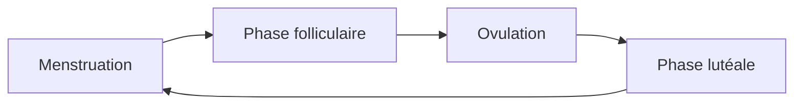
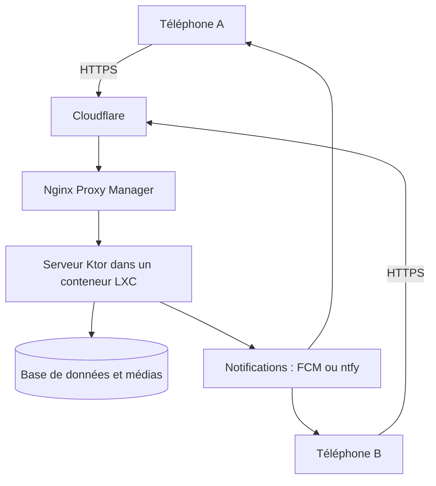
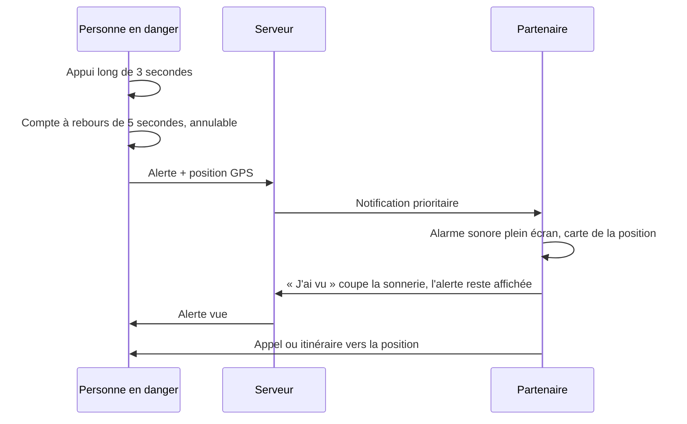
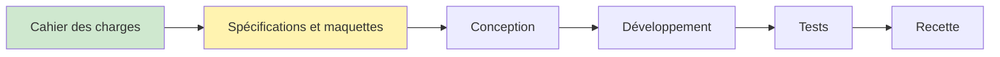

<h1 align="center">Cocooning</h1>

Une appli Android pour un couple, qui réunit au même endroit tout ce qu'on se dit, se partage et s'organise à deux.

---

## Pourquoi ce projet

Je voulais une application à nous, sans compte publicitaire ni données qui traînent chez un tiers. Les messages sont chiffrés, le serveur est chez moi, et le code est ouvert. Le projet est personnel et j'avance sans date limite.

## Ce que fait l'appli

| Besoin | Ce qu'on y trouve | Priorité |
|---|---|---|
| Se parler | Messagerie chiffrée : texte, vocal, images, GIF, vidéos | Indispensable |
| Suivre le cycle | Questions du jour, phases, notifications pour le partenaire | Indispensable |
| Être prévenu | Notifications réglables une par une | Indispensable |
| Se mettre à l'abri | Bouton S.O.S : alarme sur le téléphone de l'autre avec la position | Indispensable |
| S'organiser | Notes partagées en couleur, calendrier commun | Indispensable |
| Plus tard | Position en direct, message sur l'écran de verrouillage, widgets | Souhaitable |
| V2 | Version famille avec les enfants | Idée |

## Le cycle suivi par l'appli

Chaque jour, l'appli pose quelques questions à la personne suivie : humeur, symptômes, besoins. Le partenaire reçoit seulement une notification sur la phase en cours, pour pouvoir être là au bon moment.

## Comment ça marche

Les messages sont chiffrés sur les téléphones. Le serveur ne fait que transporter et stocker des données qu'il ne peut pas lire.

## Le bouton S.O.S

L'appui long de 3 secondes puis les 5 secondes annulables évitent les fausses alertes. La carte utilise osmdroid et les tuiles OpenStreetMap, sans services Google : elle marche aussi sur /e/OS.

Si le réseau manque, un SMS de secours prend le relais. Un téléphone en silence total reste une limite d'Android que personne ne peut contourner.

## Technologies

| Partie | Choix |
|---|---|
| Application | Kotlin, Jetpack Compose, Material 3 |
| Serveur | Kotlin avec Ktor |
| Hébergement | Conteneur LXC sur mon Proxmox, derrière Nginx Proxy Manager et Cloudflare |
| Notifications | FCM, ou UnifiedPush pour un téléphone sans services Google |
| Design | Thème Lavande poudrée, polices Baloo 2 et Montserrat, contrastes AA |
| Carte | osmdroid avec les données OpenStreetMap, sans services Google |

## Où j'en suis

Le projet suit un cycle en V.

| Étape | État |
|---|---|
| Cahier des charges | Fait |
| Direction artistique et design système | Fait |
| Projet Android et thème Compose | En cours |
| Spécifications détaillées | À venir |
| Développement, tests, recette | À venir |

## Contenu du dépôt

| Dossier | Rôle |
|---|---|
| `app/` | L'application Android |
| `core/designsystem/` | Thème et composants |
| `feature/accueil/` | Écran d'accueil : état, ViewModel, interface |
| `docs/` | Cahier des charges et décisions |
| `config/` | Modèles de configuration |

## Lancer le projet

1. Installer Android Studio et cloner le dépôt.
2. Copier le modèle de `config/` et y mettre ses propres valeurs : l'adresse du serveur et les réglages passent par un seul fichier. Les secrets ne sont jamais versionnés.
3. Laisser Gradle se synchroniser, puis lancer l'appli sur un téléphone ou un émulateur.

## Contribuer et sécurité

Les idées sont bienvenues dans les issues. Le travail passe par des branches, jamais directement par `main`. Pour une faille de sécurité, merci de prévenir le propriétaire du dépôt en privé plutôt que dans une issue publique.

## Licence

Le code de Cocooning est sous licence GNU AGPL-3.0 (fichier [`LICENSE`](LICENSE)), choix validé le 27/11/2026 : la messagerie utilise [libsignal](https://github.com/signalapp/libsignal), elle-même sous AGPL-3.0 (voir `docs/adr/0003-architecture-messagerie-chiffree.md`).

Les polices embarquées dans `core/designsystem/src/main/res/font/` sont sous licence SIL Open Font License 1.1 :

| Police | Auteurs | Licence |
|---|---|---|
| Baloo 2 | The Baloo 2 Project Authors | [`core/designsystem/licences/OFL-Baloo2.txt`](core/designsystem/licences/OFL-Baloo2.txt) |
| Montserrat | The Montserrat Project Authors | [`core/designsystem/licences/OFL-Montserrat.txt`](core/designsystem/licences/OFL-Montserrat.txt) |

La carte de l'alerte S.O.S utilise [osmdroid](https://github.com/osmdroid/osmdroid) (licence Apache 2.0) et les données © contributeurs OpenStreetMap (licence ODbL), mention affichée sur la carte.